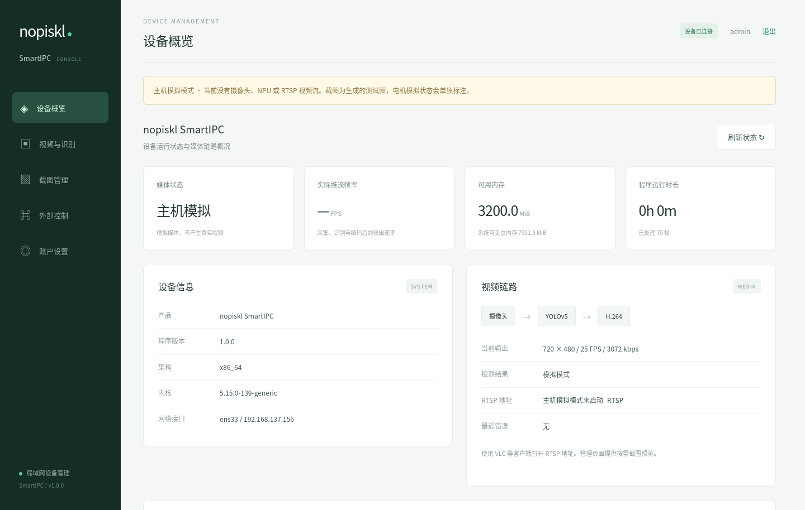
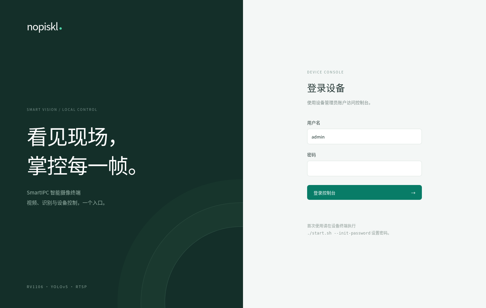
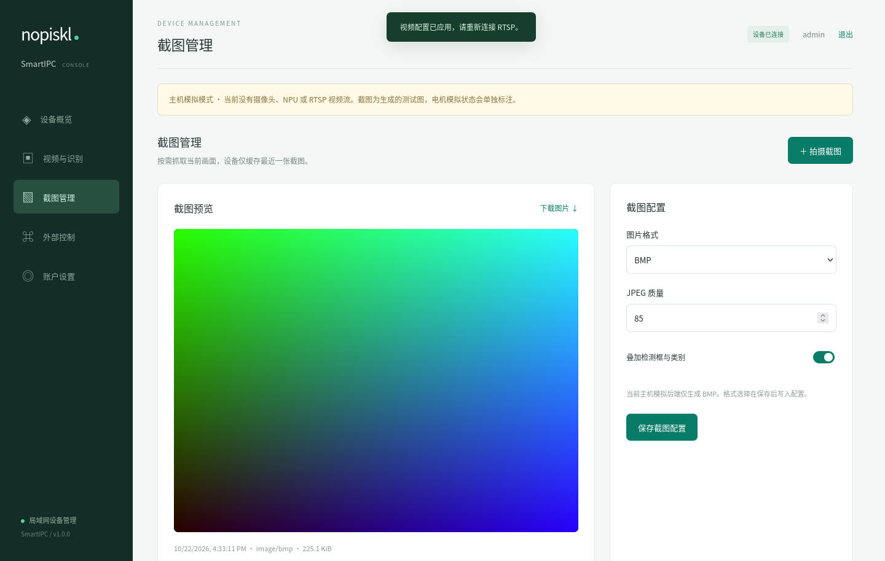
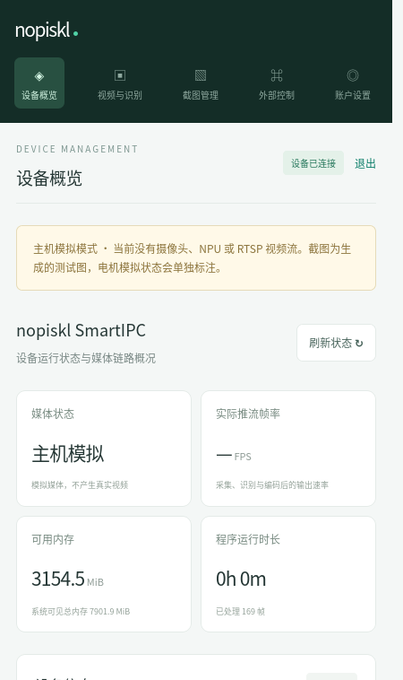
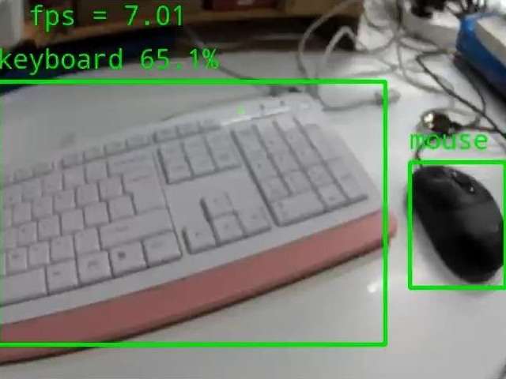

# nopiskl Video / SmartIPC

**面向 RV1106 的智能摄像头项目，集成目标检测、视频推流和浏览器设备管理。**

SmartIPC 使用摄像头采集画面，通过 RKNN 运行 YOLOv5 检测，并将带有检测结果的视频编码为 H.264，通过 RTSP 输出。在电脑或手机浏览器中，可以查看设备状态、调整视频与识别参数、拍摄和下载截图；外部程序也可以通过 HTTP API 完成这些操作。

项目基于 Luckfox 的视频示例扩展，新增了管理页面、账号登录、配置保存、截图管理和设备控制入口，并提供无需开发板即可体验管理流程的主机模拟模式。仓库同时保留两个基础视频示例，方便从采集与推流开始学习。

[功能概览](#功能概览) · [效果预览](#效果预览) · [快速上手](#快速上手) · [项目组成](#项目组成) · [详细文档](#详细文档)

## 功能概览

| 能力 | 说明 |
| --- | --- |
| 视频采集与推流 | 基于 Rockchip MPI 和 OpenCV-Mobile 处理图像，硬件编码 H.264，使用 VLC 等 RTSP 客户端观看 |
| YOLOv5 目标检测 | 使用随包的 COCO 80 类模型，支持检测开关、置信度与 NMS 阈值调整、检测框叠加 |
| 浏览器管理 | 查看设备信息、媒体状态、帧率、内存与运行时长，适配桌面和手机屏幕 |
| 参数配置 | 调整分辨率、目标帧率、码率、GOP 等参数，保存已生效配置供下次启动使用 |
| 截图管理 | 按需拍摄、预览和下载最新截图；板端支持 JPEG/BMP，可配置质量与检测结果叠加 |
| 账号与外部接口 | 提供管理员登录、密码修改和 HTTP API，可由外部程序查询状态、提交操作并获取结果 |
| 控制扩展与主机模拟 | 提供电机命令接口和模拟后端，可在 Linux 主机联调页面与控制流程；物理电机驱动待接入 |

实时视频通过 RTSP 客户端观看，管理页面提供按需截图预览。视频参数的可用范围和实际帧率取决于传感器、固件与处理负载。

## 效果预览

### 设备概览

集中查看设备运行状态、资源占用和视频输出信息。以下管理页面截图均来自本项目的主机模拟模式；截图中的状态数值与测试图用于展示界面。



### 登录与截图管理

<table>
  <tr>
    <th width="50%">管理员登录</th>
    <th width="50%">截图预览与下载</th>
  </tr>
  <tr>
    <td><a href="docs/previews/login.png"></a></td>
    <td><a href="docs/previews/snapshot.png"></a></td>
  </tr>
</table>

首次运行时在设备终端设置管理员密码。登录后可拍摄当前画面、调整截图选项并下载图片；设备仅缓存最新一张截图。

### 手机端访问

同一套管理页面适配手机屏幕，可在局域网中查看设备状态和操作入口。

<p align="center">
  <a href="docs/previews/mobile.png"></a>
</p>

### YOLOv5 检测示例

下图来自原 Luckfox 参考项目，展示目标类别、置信度和检测框叠加效果。图中的帧率属于原示例画面，SmartIPC 当前版本的板端效果与性能仍需实机验证。

<p align="center">
  <a href="docs/previews/luckfox_pico_rtsp_yolov5.jpg"></a>
</p>

图片来源：`Video_examples/luckfox_pico_rkmpi_example/images/luckfox_pico_rtsp_yolov5.jpg`；已复制到本仓库供文档展示，来源说明见 [第三方说明](THIRD_PARTY_NOTICES.md)。

## 快速上手

### 在 RV1106 开发板上运行

准备 Linux 构建环境、CMake 3.16+、make 和与固件匹配的 ARM 工具链。以下以 uclibc 为例，在项目根目录执行；将 SDK 路径替换为本机实际位置：

```bash
export NOPISKL_SDK_PATH=/path/to/luckfox-pico
./build.sh --target SmartIPC --libc uclibc --jobs 2
```

将生成的 `dist/uclibc/` 完整目录复制到设备，例如 `/userdata/SmartIPC`。确认传感器和 IQ 文件配置正确，并停止占用摄像头及 RTSP 端口的原服务，然后执行：

```sh
cd /userdata/SmartIPC
./start.sh --init-password
./start.sh
```

首次设置密码至少需要 10 字节，登录用户名为 `admin`。启动后使用：

| 入口 | 地址 |
| --- | --- |
| 浏览器管理页面 | `http://<设备IP>:8080/` |
| VLC 等客户端观看视频 | `rtsp://<设备IP>:554/live/0` |

默认视频配置为 720×480、25 目标 FPS、3072 kbps，可在管理页面调整。glibc 工具链、配置保存和部署访问说明见 [构建与部署](docs/build_and_deploy.md)。

### 没有开发板时体验管理页面

在 Linux 主机的项目根目录执行：

```bash
./build.sh --host --jobs 2
cd dist/host
./start.sh --init-password
./start.sh --simulate-motor
```

浏览器访问 `http://localhost:8080/`，即可体验登录、配置修改、截图和模拟电机控制。主机模式生成 BMP 测试图，不使用摄像头、NPU 或 RTSP。

已有主机测试与 ARM uclibc 编译检查通过；真实视频链路和连续运行稳定性仍待板端验证，具体见 [验证范围](docs/build_and_deploy.md#验证范围)。

## 项目组成

| 程序 | 用途 |
| --- | --- |
| `SmartIPC` | 主应用：目标检测、RTSP 推流、浏览器管理、截图及外部控制 |
| `nopiskl_rtsp_opencv` | 基础示例：MPI 采集、OpenCV 帧率叠加、编码与 RTSP 推流 |
| `nopiskl_rtsp_opencv_capture` | 基础示例：OpenCV VideoCapture 采集、帧率叠加、编码与 RTSP 推流 |

构建全部程序时使用 `./build.sh --target all --libc uclibc --jobs 2`。三个程序分别运行，避免同时占用摄像头；示例运行命令见 [构建与部署](docs/build_and_deploy.md#基础示例与打包)。

```text
apps/SmartIPC/    主应用、管理页面、默认配置和功能模块
examples/        基础视频示例
models/          YOLOv5 模型与标签
third_party/     平台依赖和第三方库
cmake/           构建配置与工具链
scripts/         启动、打包和开发检查脚本
tests/           自动化测试
docs/            架构、部署、接口说明与预览图片
```

## 详细文档

| 文档 | 适合了解的内容 |
| --- | --- |
| [架构与运行流程](docs/architecture.md) | 与参考项目的差异、模块职责、线程模型及视频、截图和配置流程图 |
| [构建与部署](docs/build_and_deploy.md) | 工具链、部署配置、示例运行、开发检查与验证范围 |
| [HTTP API](docs/api.md) | 登录鉴权、参数配置、任务状态和截图下载 |
| [电机协议](docs/motor_protocol.md) | 命令含义、模拟控制与物理驱动接入 |

## 来源与致谢

本项目基于 **LuckfoxTECH 的 `luckfox_pico_rkmpi_example`** 整理和扩展，沿用 Rockchip MPI、RKNN、RTSP 等平台能力及原示例模型，并使用 OpenCV-Mobile、CivetWeb、Monocypher 和 nlohmann/json。各组件、模型和示例图片的来源见 [第三方说明](THIRD_PARTY_NOTICES.md)。
