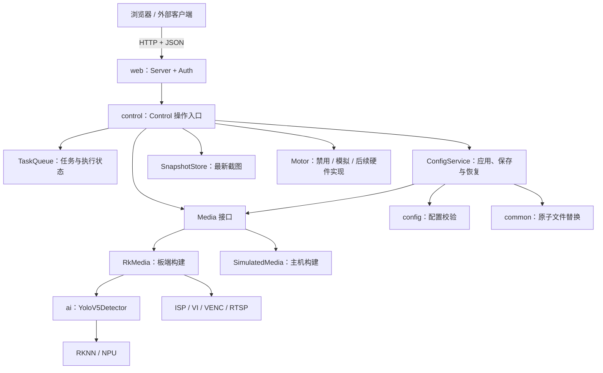
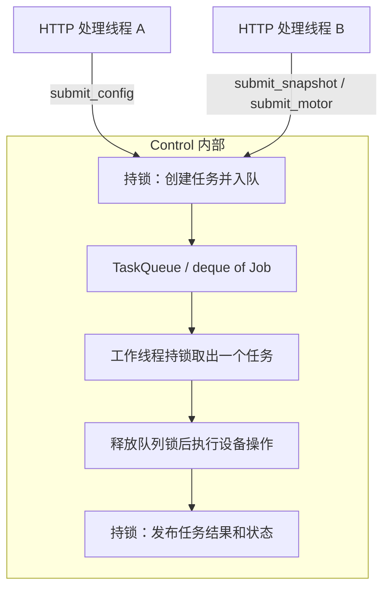
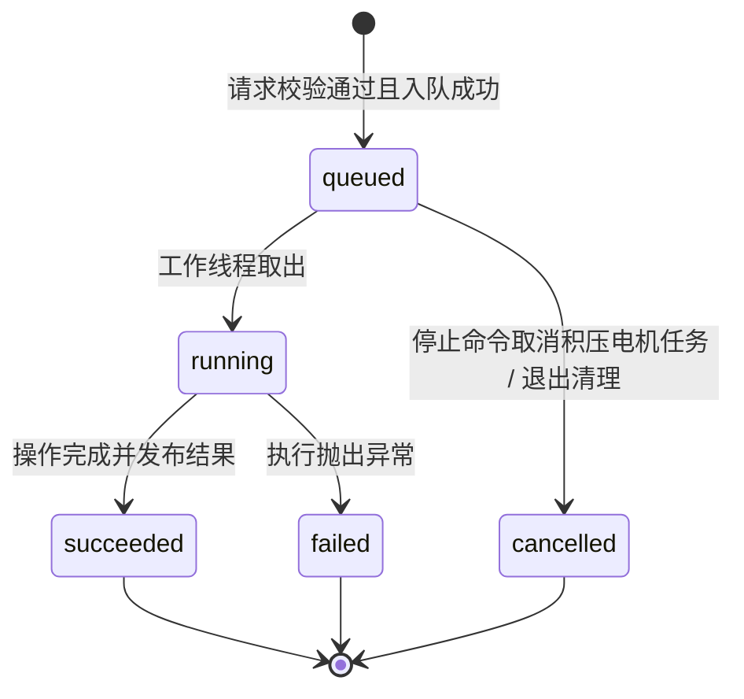
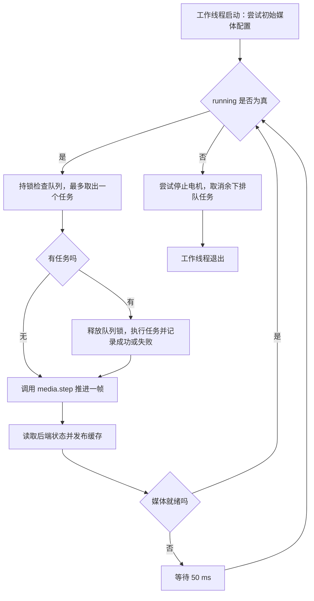
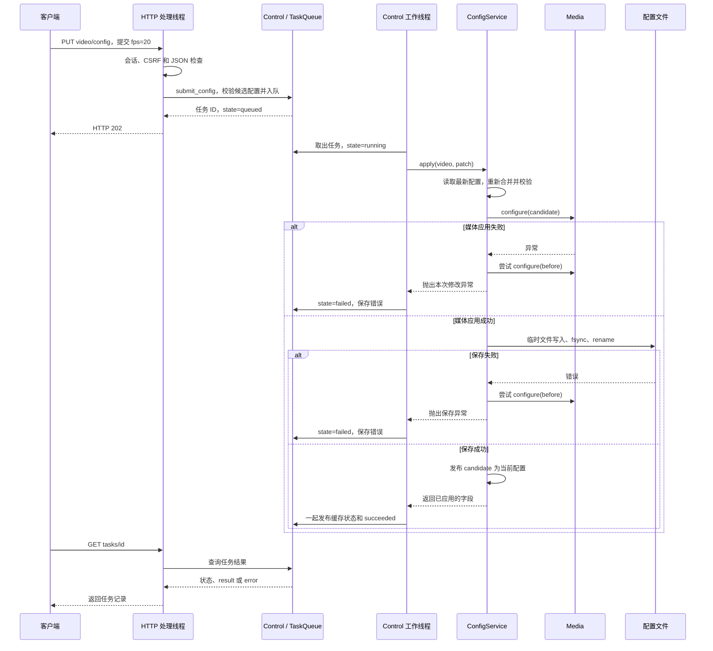
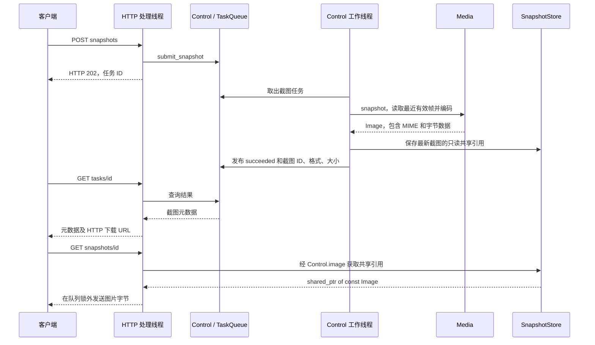
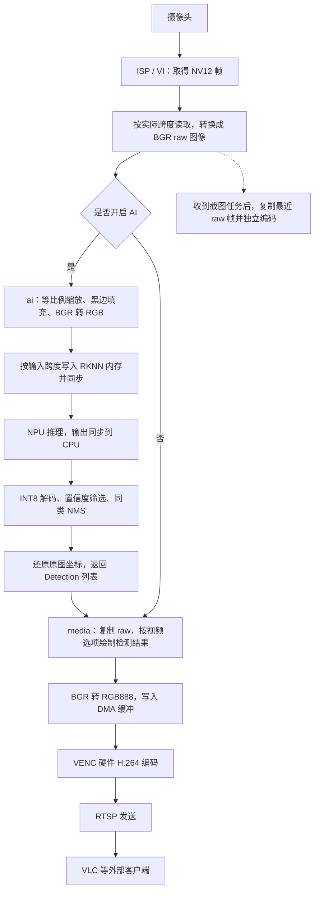
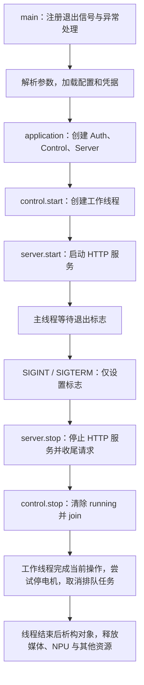

# SmartIPC 架构与运行流程

本文说明当前代码如何组织、请求由哪个线程处理、视频帧怎样流动，以及为什么需要 `Control`。内容按 2026-10-25 工作区代码核对；构建和运行检查的结果见 [验证范围](build_and_deploy.md#验证范围)，本次文档整理不代表新增板端测试。

SmartIPC 是运行在 RV1106 上的单进程 C++ 应用。它把视频采集、YOLOv5 检测和 RTSP 推流组织成可管理的设备服务，并提供浏览器页面、HTTP API、配置保存、截图和电机扩展接口。应用模块通过 C++ 接口调用；HTTP 是外部管理入口。

阅读顺序：先看 [来源与改动](#1-来源与改动)、[模块边界](#2-目录与模块边界) 和 [Control 的职责](#3-为什么需要-control)，再理解 [线程与任务队列](#4-线程与生产者消费者模型)。具体操作见 [配置修改](#5-配置修改与失败恢复)、[截图](#6-截图与下载) 和 [视频链路](#7-板端视频与-ai-数据流)。

## 1. 来源与改动

参考项目是 LuckfoxTECH 的 `luckfox_pico_rkmpi_example`，工作区位置为 `Video_examples/luckfox_pico_rkmpi_example`。原项目已经包含 MPI/OpenCV 采集、RKNN YOLOv5 推理、检测框叠加、H.264 编码和 RTSP 推流。原 YOLOv5 示例的 `main.cc` 将这些步骤和资源初始化集中在一个程序入口中。

当前项目沿用了供应商 SDK、预编译库、RKNN 模型和 COCO 标签。核对时，随包 `yolov5.rknn` 和标签文件的 SHA-256 与参考项目一致。来源与署名见 [第三方说明](../THIRD_PARTY_NOTICES.md)。

| 方面 | 参考项目 | 当前实现 |
| --- | --- | --- |
| 程序组织 | OpenCV、VideoCapture、两个 RetinaFace 和 YOLOv5 共五个演示 | SmartIPC 主应用加两个基础视频示例；移除 RetinaFace 示例及模型 |
| 管理入口 | 终端日志和 RTSP 客户端 | 新增 Web 页面、`/api/v1`、设备信息与状态查询 |
| 视频和 AI 参数 | 多项参数写在示例源码中 | 默认 JSON、已保存配置、运行时字段校验和修改 |
| 设备命令 | 主循环直接调用设备 | 有界任务队列、异步结果、串行设备操作、失败记录 |
| 截图 | YOLOv5 示例主要提供视频流 | 按需 JPEG/BMP 编码、独立叠加选项、最新截图缓存和下载 |
| 账户 | 没有当前这套管理会话 | 密码初始化、Argon2id 哈希、Cookie 会话、CSRF 和登录限速 |
| 电机 | 无对应控制体系 | 命令接口、停止优先级、禁用及模拟后端 |
| 验证和复用 | 以开发板示例为主，各示例分别维护媒体流程 | 主机模拟、自动化测试、模块库、公共媒体实现 |

视频和推理实现还做了以下调整：

- [板端媒体后端][rk-media] 处理 NV12 的实际行跨度和虚拟高度，明确 BGR/RGB 转换、缓存同步及编码包偏移；VI 帧与 VENC 码流通过局部资源守卫释放。
- [检测器][detector-src] 接管模型、预处理缓存和 RKNN 输入，完成 letterbox、输入跨度处理、同步推理及原图坐标还原。
- [模型实现][yolov5-src] 在初始化失败时清理已分配资源，并校验当前支持的输入输出布局。
- [后处理][postprocess] 按排序后的实际类别执行 NMS，增加输出缓冲区检查，限制进入 NMS 的候选数量。标签由实例持有，避免共享可变全局标签。
- 自有实现统一为 `.cpp`；移除未使用的 RKNN 字段、未读取的 `anchors_yolov5.txt`，以及失效的构建产物和缓存。有效 anchors 保留在后处理代码中。
- 程序启动时检查设备占用，不自动执行原示例中的 `RkLunch-stop.sh`；资源冲突由部署阶段处理。

这些是代码组织与实现行为的变化。板端检测效果、帧率和连续运行稳定性仍以实际验收为准。

## 2. 目录与模块边界

```text
nopiskl_video/
├── apps/SmartIPC/
│   ├── src/
│   │   ├── main.cpp             信号注册、顶层异常处理
│   │   ├── application.cpp      配置加载、后端选择、服务组装与启停
│   │   ├── options.cpp          命令行解析
│   │   └── admin_setup.cpp      首次密码输入、终端回显与缓冲清理
│   ├── config/default.json      随包默认配置
│   ├── web/                     浏览器端 HTML、CSS、JavaScript
│   └── modules/
│       ├── web/                 C++ HTTP 服务、鉴权与 API 路由
│       ├── control/             调度、任务、配置事务、截图缓存、电机接口
│       ├── media/               媒体接口及板端/主机模拟实现
│       ├── ai/                  模型、预处理、推理与后处理
│       ├── config/              配置加载、字段规则和参数约束
│       └── common/              公共类型、文件、时间、随机数和系统信息
├── examples/                    两个复用媒体模块的基础示例
├── models/                      RKNN 模型与标签
├── third_party/                 开源依赖及供应商头文件、库
├── cmake/                       工具链、依赖、编译选项和安装规则
├── scripts/                     启动、打包和代码检查脚本
├── tests/                       主机测试和浏览器检查
└── docs/                        设计、协议与部署说明
```

`apps/SmartIPC/web/` 保存浏览器端资源，`apps/SmartIPC/modules/web/` 实现设备端 HTTP 服务，二者通过 API 交互。

每个功能模块具有自己的 `CMakeLists.txt`；`include/nopiskl/<模块>/` 保存公开接口，`src/` 保存实现及私有辅助头文件。跨模块包含路径例如 `nopiskl/media/media.h`，`src/` 不作为公开包含目录。

下图展示调用与协作关系。节点代表职责或对象，不代表各自拥有线程；真实媒体和模拟媒体在编译时二选一。



| 模块 | 对外承担的职责 | 主要实现入口 |
| --- | --- | --- |
| 应用组装 | 决定后端，连接 Auth、Control、Server，管理启停 | [application.cpp][application] |
| `web` | HTTP、鉴权、CSRF、静态资源、路由、响应及截图 URL | [server.cpp][server]、[auth.cpp][auth] |
| `control` | 调度设备操作，组织配置、截图、电机任务，提供结果与状态 | [control.h][control-api]、[control.cpp][control-src] |
| `media` | 配置媒体通道、推进一帧、生成截图、报告媒体状态 | [media.h][media-api]、[rk_media.cpp][rk-media] |
| `ai` | 从借用的 BGR 图像得到原图坐标下的检测结果 | [detector.h][detector-api]、[detector.cpp][detector-src] |
| `config` | 加载配置、检查字段与参数范围 | [config.cpp][config-src] |
| `common` | 公共 JSON/错误类型、文件操作和系统工具 | [files.cpp][files]、[system.cpp][system] |

`config` 模块定义“哪些配置合法”；控制模块内的 `ConfigService` 定义“怎样应用、保存和恢复配置”。HTTP 路由通过 Control 提交修改，具体媒体后端只负责设备配置应用。

## 3. 为什么需要 Control

`Control` 是设备操作的统一协调服务。SmartIPC 会同时收到修改分辨率、截图、状态查询等请求，而分辨率修改需要关闭并重建 VI/VENC。若 HTTP 请求直接操作媒体设备，就需要在每个请求入口协调“资源正在使用”和“资源正在销毁”的关系。

当前设计将运行期的媒体配置、逐帧处理、截图和电机动作集中到一个工作线程，按确定顺序调用后端。Control 同时组织跨组件流程，例如“修改设备成功后保存配置，保存失败则尝试恢复设备”，并保存客户端可查询的任务结果。

### 3.1 对外接口

| 接口 | 调用时发生什么 | 是否进入任务队列 |
| --- | --- | --- |
| `submit_config(section, patch)` | 即时校验并提交配置修改 | 是；执行时按最新配置再次合并、校验 |
| `submit_snapshot()` | 提交截图请求，返回任务记录 | 是；图像编码在工作线程执行 |
| `submit_motor(command)` | 校验命令和后端可用性，提交动作 | 是；`stop` 使用优先规则 |
| `config(section)` | 读取当前对外发布的配置副本 | 否；使用 ConfigService 的锁 |
| `status()` | 汇总缓存的后端状态、待处理任务及系统信息 | 否；HTTP 线程不直接查询硬件后端 |
| `task(id)` | 读取任务状态、结果或错误 | 否；读取任务记录 |
| `image(id)` | 获取截图的只读共享引用 | 否；不重新编码图像 |
| `start()` / `stop()` | 创建工作线程 / 请求停止并等待线程退出 | 否；由应用生命周期管理 |

`submit_*` 接收成功只代表入队成功。HTTP 层将它表示为 `202 Accepted`；最终执行结果通过任务 ID 查询。无效参数、队列满或禁用电机等情况可以在入队前直接失败。错误码和字段详见 [API](api.md)。

`Control::stop()` 用于结束控制工作线程；`submit_motor()` 中的 `action=stop` 用于提交电机停止任务，后者不会结束视频和控制服务。

### 3.2 内部组件与后端所有权

| 对象 | 保存或管理的内容 |
| --- | --- |
| `TaskQueue` | `Job` 队列、任务状态、结果、错误及历史淘汰顺序 |
| `ConfigService` | 当前发布的配置、文件路径、校验、应用、保存和恢复流程 |
| `SnapshotStore` | 最新一张截图的 ID 和 `shared_ptr<const Image>` |
| `Media` / `Motor` | 具体设备操作，由 Control 持有 `unique_ptr` |
| `media_state` / `motor_state` | 工作线程发布的状态副本，供查询线程读取 |

应用在 [application.cpp][application] 中组装对象：

```cpp
Auth auth(options.data);
Control control(config, options.data, make_media(true), make_motor(options.simulate_motor));
Server server(control, auth, options.web);
```

Control 接管传入后端的所有权，空后端立即报错。真实硬件、模拟实现或测试替身由组装层决定；Control 只依赖媒体和电机接口，因此可以在没有 Rockchip 库的主机上测试任务失败、配置恢复和退出行为。

公开头文件中的 `struct Impl` 与 `std::unique_ptr<Impl>` 是私有实现封装，用来隐藏队列、互斥锁、线程和缓存。`Impl` 本身不提供线程同步，线程安全由具体锁和后端访问约束保证。

## 4. 线程与生产者—消费者模型

### 4.1 哪些线程参与应用逻辑

| 线程 | 工作内容 |
| --- | --- |
| 主线程 | 参数与配置加载、对象组装、启动服务、观察退出标志、停止和析构 |
| CivetWeb 的 2 个 HTTP 处理线程 | 登录、请求解析、任务提交、状态查询、图片下载 |
| Control 的 1 个工作线程 | 初始媒体配置、消费设备任务、调用 `media->step()`、更新设备状态 |

表中列出的是应用关心的角色，不能据此认定整个进程只有这些线程；HTTP 库、SDK 和驱动可能还有内部执行机制。实际线程数量需在目标环境观察。

后端对象在主线程构造，Control 构造期间会读取一次 `Motor::status()`；正常运行期的媒体和电机操作集中在工作线程。退出并完成 `join()` 后，后端对象由主线程析构。新增后端应同时考虑这三个生命周期阶段。

### 4.2 命令队列是多生产者、单消费者

HTTP 处理线程调用 `submit_*`，产生 `Job`；单个 Control 工作线程取出并执行任务。这构成多生产者、单消费者模型，简称 MPSC。



`Job` 包含 `id`、`kind`、`section` 和 `payload`。当前 `JobKind` 有 `config`、`snapshot`、`motor` 三种。具体结构见 [task_queue.h][task-api]。

同步边界如下：

- `TaskQueue` 和 `SnapshotStore` 内部没有自己的锁，由 Control 的同一把互斥锁保护，不能绕过 Control 在其他线程中无锁调用。
- 入队、出队、任务记录访问和状态发布持锁；媒体重配置、图像编码和电机执行不一直占用这把锁。
- ConfigService 使用独立互斥锁保护当前配置；耗时的应用与保存依靠单个工作线程串行执行。
- 任务成功结果与对应缓存状态在同一临界区发布。多个查询接口分别读取数据，并不组成一次跨接口的原子快照。
- `running` 是原子标志，控制工作循环退出；`stop()` 通过 `join()` 等待线程结束。

### 4.3 队列容量、优先级与状态

普通请求在待执行队列长度达到 16 时被拒绝，返回 `503 queue_full`。生产者不会阻塞等待空位。电机 `stop` 可以绕过这一普通请求限制，先取消队列中尚未执行的电机任务，再插入队头，因此队列可以临时超过 16 项。

任务记录保留最近 64 项，入队时优先淘汰最早插入且已经结束的记录；过期 ID 查询返回 404。任务状态与等待队列是不同的数据：任务出队后变为 `running`，记录仍保留。



优先入队只调整待执行任务的顺序，不能打断已经运行的推理、截图编码或媒体重配置。当前电机后端只有 disabled/simulated；模拟 `move` 任务成功表示后端接受并启动动作，运动是否结束仍需查询状态。物理驱动的完成语义见 [电机协议](motor_protocol.md)。

### 4.4 消费者同时推进视频循环

[Control::Impl::run()][control-src] 的每轮循环最多取出一个任务，然后调用一次 `media->step()`，最后发布设备状态。媒体未就绪时，循环末尾等待 50 ms；真实媒体的 `step()` 自身也包含取帧等待和帧率节奏控制。



当前没有使用 `condition_variable` 等待任务：队列为空时仍需要推进视频。如果改成“无任务就无限等待”，视频也会停下来。后续若使用条件变量，必须同时设计帧处理的唤醒或超时机制。

**命令存在跨线程队列，视频帧目前在同一工作线程内顺序经过采集、推理和编码。** 当前没有独立的采集线程、推理线程和编码线程，也没有它们之间的图像队列。

这种组织方式让设备访问顺序清楚，但视频处理和设备命令会相互影响耗时。推理、截图或重配置较慢时，下一条命令需要等待；控制队列不等于提高视频吞吐量的并行流水线。

## 5. 配置修改与失败恢复

### 5.1 配置从哪里来

启动时先读取随包默认配置；如果 `data/config.json` 存在，[load_config()][config-src] 用已保存文件整体替换默认配置，再进行校验。运行期 `PUT` 使用字段合并，未提交字段保留。

HTTP 开放视频、AI 和截图三个配置分组。模型路径、标签路径、HTTP 监听、RTSP 端口和设备名称由离线配置设置。字段与取值范围见 [API 文档](api.md)。

### 5.2 从 HTTP 请求到配置发布

以 `PUT /api/v1/video/config` 提交 `{"fps":20}` 为例：



在执行时重新合并配置是必要的。例如两个请求分别修改 `fps` 和 `bitrate_kbps`，第二个任务应基于第一个任务完成后的配置合并，才能保留先前的修改。[ConfigService::apply()][config-service] 负责这一顺序。

视频配置实际发生变化，或媒体当前未就绪时，板端后端会关闭并重新建立通道。正常就绪时，AI 阈值和截图选项修改不会主动重建视频通道。视频任务结果提供 RTSP 重连提示。

### 5.3 对外状态与恢复边界

`config()` 返回启动时加载、或最近一次成功应用并保存后发布的配置。**启动时能查询到配置，不代表初始硬件配置已经成功**；必须同时看 `status().media.ready` 和错误信息。运行期修改任务完成前，配置查询通常仍返回上一份已发布配置。

应用或保存失败后尝试恢复旧配置；恢复本身也可能失败。恢复成功时媒体可继续使用旧配置，本次修改任务仍报告失败。恢复失败时后端关闭通道并记录错误，工作循环刷新媒体状态，同时输出恢复失败日志，不能把“已尝试回滚”当作硬件一定恢复成功。

[atomic_write()][files] 使用同目录临时文件，以 0600 权限创建，写入后先 `fsync` 再 `rename`，随后尝试同步父目录。这保护文件替换过程；设备应用和文件保存之间依然存在时间窗口，不构成硬件、文件和任务状态整体的原子事务。

## 6. 截图与下载

截图任务使用最近一次有效视频帧，不额外启动采集线程。板端媒体在未就绪、没有图像或最后一帧超过 2 秒时拒绝截图。编码选项独立控制截图是否叠加检测结果。



上图展示成功路径；编码异常或图片超过 8 MiB 时，任务变为 `failed`。失败截图不会替换之前成功保存的图片。

缓存只索引最新一张截图，下一次成功截图会让旧 ID 的新下载请求返回 404。已经开始下载的 HTTP 线程持有只读共享引用，即使新截图替换了缓存，旧字节数据也会保留到该下载结束。因此“只缓存最新一张”不意味着任意时刻进程中最多只有一份图片内存。

控制层只返回截图标识和元数据，下载 URL 在 [Server 路由][server] 中生成。截图默认只存内存，重启后丢失；客户端可下载保存，项目当前没有周期截图归档功能。实现入口为 [SnapshotStore][snapshot-store] 和 [Media::snapshot()][rk-media]。

## 7. 板端视频与 AI 数据流

SmartIPC 主应用使用 MPI 采集。`media->step()` 在控制工作线程中同步推进以下处理；图中的节点不对应独立线程。



`RkMedia` 管理 ISP、VI、VENC、RTSP、OpenCV 图像和 DMA 块；`YoloV5Detector` 管理 RKNN 模型、张量内存、标签和预处理缓存。绘制图框与文字留在媒体层。

检测器接口接收 `BgrImageView`，包含数据指针、宽高、行跨度和缓冲区大小，输出 `Detection` 列表。图像内存在同步调用期间借用，所有权仍属于媒体后端；检测器不保存用于异步处理的输入引用。

目前模型适配范围是单输入、三输出、80 类 COCO YOLOv5。输入尺寸从张量属性读取，后处理使用固定 anchors，最多保留 1024 个候选进入 NMS、输出 128 个结果。替换不同类别数或布局的模型需要一起修改前后处理，不能只换模型文件或外部 anchors 文本。

基础示例通过 [example_runner.cpp][example-runner] 调用同一个媒体工厂并关闭 AI：`nopiskl_rtsp_opencv` 使用 MPI，`nopiskl_rtsp_opencv_capture` 使用 OpenCV VideoCapture。它们各自直接推进 `media->step()`，不创建 SmartIPC 的 Control 和 Web 服务，也不能与主应用同时占用摄像头。

## 8. 生命周期、故障与资源

### 8.1 启动和退出顺序



工作线程中的初始媒体配置和主线程启动 HTTP 可以并行发生；`control.start()` 返回不表示摄像头已经就绪。媒体初始化失败会记录错误，HTTP 服务仍可提供状态查询和配置入口。首次密码初始化由独立命令行路径完成，不启动这些服务。

运行中取帧、推理或编码失败时，板端媒体关闭通道并记录原因，避免继续复用可能仍被驱动引用的 DMA。当前没有自动重启媒体的循环；排查故障后重新应用配置可尝试恢复。

MPI SYS 初始化先于 DMA 分配。局部 `ViFrame` 和 `EncodedFrame` 守卫只释放已经成功取得的资源，异常路径也会执行。最终媒体资源释放发生在工作线程退出之后的后端析构中。

VI 取帧、VENC 送帧和取码流当前各使用 300 ms 超时；RKNN、配置重建和 OpenCV VideoCapture 等操作仍有各自的耗时。因此 `stop()` 等待线程退出的总时长不能简单按 300 ms 计算，优先停止任务也没有硬实时保证。

### 8.2 资源与访问边界

| 项目 | 当前实现 |
| --- | --- |
| HTTP | 2 个处理线程，关闭 keep-alive；请求大小及 JSON body 分别限制 8192 字节，JSON 嵌套最多 8 层 |
| 设备任务 | 普通请求在队列达到 16 时拒绝；停止命令可优先进入；历史保留最近 64 项 |
| 截图 | 最新 ID 对应一张图片，单张上限 8 MiB；正在下载的旧引用可暂时存活 |
| 板端媒体缓冲 | MPI 路径配置 2 个 VI 缓冲、1 个 RGB DMA 块、2 个编码码流缓冲 |
| 检测器 | 持有模型、张量和可复用的预处理图像，输入图像由调用方借出 |
| 登录计算 | Argon2id 临时使用 8 MiB 工作内存，Auth 互斥锁串行保护登录计算 |
| 账户与配置文件 | 通过原子替换保存，文件权限为 0600，不由静态文件服务公开 |

上述数量不是进程总内存上限，还需计入线程栈、SDK、驱动、图像副本、模型及编码缓存。实际占用和持续运行行为应在开发板测量。

管理页面只公开指定静态文件；除登录外的 API 要求会话，写操作额外检查 CSRF。当前未启用 TLS；HTTP 管理会话没有为 RTSP 添加鉴权。网络部署条件见 [README](../README.md)，登录接口和时效见 [API](api.md)。

## 9. 构建依赖与主机模拟

[顶层 CMake](../CMakeLists.txt) 负责公共依赖、应用、示例、测试和安装；[SmartIPC 的 CMake](../apps/SmartIPC/CMakeLists.txt) 按依赖顺序添加模块。每个模块维护自己的源文件列表、公开包含路径和链接依赖。示例与测试复用库目标，不依赖 SmartIPC 可执行文件。

| 构建目标 | 职责与依赖边界 |
| --- | --- |
| `nopiskl_common` | JSON/错误类型、文件与系统工具，无媒体和 HTTP 库依赖 |
| `nopiskl_config` | 配置规则和加载，依赖 common |
| `nopiskl_media_api` | 公开媒体接口的 INTERFACE 目标，不包含实际媒体实现 |
| `nopiskl_postprocess` | 后处理与标签，只需 RKNN 张量声明，可在主机用合成数据测试 |
| `nopiskl_ai` | 板端检测器，私有链接后处理、RKNN 和 OpenCV，不引入 ISP/MPI 依赖 |
| `nopiskl_media` | 编译时选择 `rk_media.cpp` 或 `simulated_media.cpp`，对外提供同一接口 |
| `nopiskl_control` | 依赖媒体接口、配置与线程库，不链接具体媒体实现或 HTTP 库 |
| `nopiskl_web` | HTTP、鉴权与路由，私有链接 Control、CivetWeb 和密码库 |
| `SmartIPC` | 将具体后端与 Control、Server 组装到同一个可执行程序 |

`NOPISKL_HOST_SIMULATOR` 决定媒体后端的编译选择，不是运行时切换硬件的开关。主机后端生成 320×240 BMP 测试图，不运行摄像头、NPU 和 RTSP；控制与 HTTP 层可用于验证配置和任务流程。`--simulate-motor` 则独立控制是否使用模拟电机，主机和 ARM 程序均可显式启用。

主机完整构建还逐个编译 13 个公开头文件，检查其独立包含能力。工具链、安装目录和启动方式见 [构建部署](build_and_deploy.md)；`build/<profile>/compile_commands.json` 可用于 IDE 索引。

## 10. 已验证范围与后续修改入口

已有构建与测试结果统一见 [验证范围](build_and_deploy.md#验证范围)，复现命令见同页的 [开发检查](build_and_deploy.md#开发检查)。主机模拟验证控制和接口行为；真实摄像头、NPU、JPEG、RTSP、连续运行内存和 glibc 构建仍需验证。

当前管理页面提供按需截图预览和 RTSP 地址，尚无浏览器实时视频播放。电机后端只有禁用和模拟两种，尚无物理驱动。进一步拆分采集/推理/编码线程属于后续设计，需要定义图像所有权、队列容量、积压帧丢弃策略，以及重配置和停止的同步规则，当前代码没有实现这套流水线。

| 要理解或修改的行为 | 优先阅读 |
| --- | --- |
| 程序从哪里启动、后端怎样选择 | [main.cpp][main] → [application.cpp][application] |
| 请求怎样入队、由谁执行 | [control.h][control-api] → [control.cpp][control-src] → [task_queue.cpp][task-src] |
| 修改参数后怎样保存、失败怎样恢复 | [config.cpp][config-src] → [config_service.cpp][config-service] |
| 截图怎样编码、缓存和下载 | [rk_media.cpp][rk-media] → [snapshot_store.cpp][snapshot-store] → [server.cpp][server] |
| 一帧怎样完成检测和推流 | [rk_media.cpp][rk-media] → [detector.cpp][detector-src] → [yolov5.cpp][yolov5-src] / [postprocess.cpp][postprocess] |
| 新增硬件或外部控制入口 | [media.h][media-api]、[control.h][control-api]、[application.cpp][application]、[电机协议](motor_protocol.md) |

[main]: ../apps/SmartIPC/src/main.cpp
[application]: ../apps/SmartIPC/src/application.cpp
[control-api]: ../apps/SmartIPC/modules/control/include/nopiskl/control/control.h
[control-src]: ../apps/SmartIPC/modules/control/src/control.cpp
[task-api]: ../apps/SmartIPC/modules/control/src/task_queue.h
[task-src]: ../apps/SmartIPC/modules/control/src/task_queue.cpp
[config-service]: ../apps/SmartIPC/modules/control/src/config_service.cpp
[snapshot-store]: ../apps/SmartIPC/modules/control/src/snapshot_store.cpp
[media-api]: ../apps/SmartIPC/modules/media/include/nopiskl/media/media.h
[rk-media]: ../apps/SmartIPC/modules/media/src/backends/rk_media.cpp
[detector-api]: ../apps/SmartIPC/modules/ai/include/nopiskl/ai/detector.h
[detector-src]: ../apps/SmartIPC/modules/ai/src/detector.cpp
[yolov5-src]: ../apps/SmartIPC/modules/ai/src/yolov5.cpp
[postprocess]: ../apps/SmartIPC/modules/ai/src/postprocess.cpp
[config-src]: ../apps/SmartIPC/modules/config/src/config.cpp
[server]: ../apps/SmartIPC/modules/web/src/server.cpp
[auth]: ../apps/SmartIPC/modules/web/src/auth.cpp
[files]: ../apps/SmartIPC/modules/common/src/files.cpp
[system]: ../apps/SmartIPC/modules/common/src/system.cpp
[example-runner]: ../examples/common/example_runner.cpp
